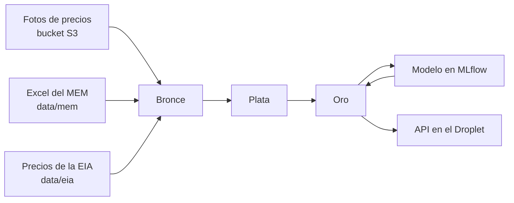

# equipo-01-gasolina-gt

Proyecto final de MLOps, Equipo 01: predicción del precio de la gasolina en Guatemala.

Un pipeline de punta a punta en Databricks convierte fotos de precios y datos oficiales en tablas Delta con la arquitectura medallón. Con eso predice si el precio de la gasolina súper, regular y el diésel subirá, bajará o se mantendrá la semana siguiente. Una API en un Droplet de DigitalOcean publica los precios y las predicciones de la capa de oro.

El enunciado oficial está en [docs/contexto/](docs/contexto/). Toda la documentación está en [docs/](docs/README.md), y el punto de partida es el [plan de implementación](docs/plan/plan_implementacion.md).

> [!IMPORTANT]
> **El Excel del MEM se actualiza a mano cada lunes.** El job corre solo cada martes, pero nada descarga el Excel del MEM de forma automática. Si nadie lo actualiza, la referencia y la predicción se calculan con la semana anterior. Ver [Actualizar los datos](#actualizar-los-datos).

## Cómo funciona



1. **Fuente principal: las fotos de precios** que comparte el catedrático. Se leen desde S3 por una external location y se convierten en precios estructurados.
2. **Fuentes complementarias,** que el enunciado permite para tener más historia: el Excel de precios del MEM, desde 2013, y el precio internacional de la gasolina y el diésel publicado por la EIA. Se versionan en `data/` y cada cambio pasa un test de "no empeorar".
3. **El job `equipo-01-pipeline`** lleva los datos de bronce a oro, entrena el modelo, lo registra en MLflow y guarda la predicción de la semana siguiente en `gold.predicciones`. Corre cada martes y avisa por correo si falla.
4. **La API** lee las tablas de oro y responde con los precios, la predicción y las métricas del modelo.

## Estructura

| Carpeta | Contenido |
|---|---|
| `databricks.yml`, `resources/` | Bundle de Databricks: los jobs, sus tareas, parámetros, programación y alertas |
| `databricks/notebooks/` | Un notebook por tarea del pipeline |
| `databricks/sql/tablas.sql` | Columnas, tipos y comentarios de todas las tablas. Para cambiar una tabla, ver [Cómo cambiar una tabla](docs/datos/esquemas_medallion.md#cómo-cambiar-una-tabla) |
| `src/gas_price/` | Código compartido: lectores del MEM y la EIA, variables, modelo y predicción |
| `tests/` | Tests del paquete, de "no empeorar" los datos y de la definición de las tablas |
| `scripts/` | Actualizar la EIA y evaluar el modelo en local |
| `data/` | Excel del MEM y archivos de la EIA |
| `infra/sql/` | Catálogo, esquemas y volumen de Unity Catalog |
| `.github/workflows/` | Plan del bundle y tests en cada PR. Despliegue y creación de tablas al hacer merge |
| `docs/` | Documentación, enunciado y diagramas |

**Equivalencia con la estructura sugerida en el enunciado:**

| Enunciado | Este repo | Por qué |
|---|---|---|
| `pipelines/01_bronze.py`, `02_silver.py`, `03_gold.py` | `databricks/notebooks/`, con prefijos 1x para bronce, 2x para plata, 3x a 5x para oro | Un notebook por fuente y por paso. Cada tarea se puede probar y volver a correr por separado |
| `pipelines/job.json` | `resources/pipeline.yml` | El job se define como código con un bundle de Databricks y lo despliega el CI. Ver [ci_cd.md](docs/infraestructura/ci_cd.md) |
| `api/` | `api/` | Por hacer |
| `docs/arquitectura.png` y su fuente editable | Por hacer | |
| `docs/informe.pdf` | Por hacer | |
| `presentacion/` | Por hacer | |

## Uso local

Requisito: Python 3.11 o más reciente.

```
python -m venv .venv
.venv\Scripts\activate          # en Linux o Mac: source .venv/bin/activate
pip install -e ".[test]"
```

| Comando | Para qué |
|---|---|
| `pytest` | Correr los tests |
| `python scripts/evaluar_modelo.py` | Evaluar el modelo contra la línea base con los datos de `data/` |
| `python scripts/actualizar_eia.py` | Descargar los precios nuevos de la EIA |

## Actualizar los datos

Cada lunes, antes de que el job corra el martes:

1. Crear una rama.
2. Reemplazar `data/mem/precios_promedio_nacionales_diarios.xlsx` con la descarga más reciente del MEM.
3. Correr `python scripts/actualizar_eia.py`.
4. Abrir un pull request. Los checks `plan` y `tests` tienen que pasar.
5. Hacer merge. El job del martes carga los datos nuevos. Para cargarlos antes, correr `equipo-01-pipeline` con **Run now**.

Detalle en [fuentes_de_datos.md](docs/datos/fuentes_de_datos.md#ciclo-semanal-de-actualización).

## Dónde quedan los resultados

| Qué | Dónde |
|---|---|
| Tablas | Catálogo `equipo_01`, esquemas `bronze`, `silver` y `gold` |
| Predicción de la semana siguiente | `equipo_01.gold.predicciones` |
| Métricas del modelo y de la línea base | `equipo_01.gold.metricas_modelo` |
| Precio oficial vigente | `equipo_01.gold.referencia_actual` |
| Experimento | `/Shared/equipo-01-tendencia` |
| Modelo | `equipo_01.gold.modelo_tendencia_precio`, alias `champion` |
| Jobs | `equipo-01-pipeline`, `equipo-01-setup` y `equipo-01-exploracion` |

Solo el CI despliega a Databricks. Ver [ci_cd.md](docs/infraestructura/ci_cd.md).
