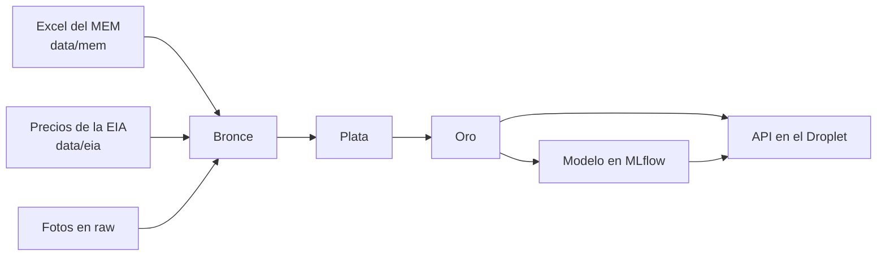

# MLOPS_GAS_PRICES_PROJECT

Proyecto final de MLOps: monitoreo del precio de la gasolina en Guatemala.

El usuario ingresa el precio de la gasolina de hoy y el sistema responde si es un buen precio y si se espera que suba o baje en el próximo cambio de referencia.

Toda la documentación está en [docs/](docs/README.md). El punto de partida es el [plan de implementación](docs/plan/plan_implementacion.md).

> [!IMPORTANT]
> **Los datos se actualizan cada lunes, a mano.** El MEM cambia el precio oficial casi siempre los lunes. Nada descarga el Excel del MEM de forma automática. Si nadie lo actualiza, la API sigue comparando contra el precio de la última actualización y el modelo predice con datos viejos. Ver [Actualizar los datos](#actualizar-los-datos).

## Cómo funciona



1. Los datos del MEM y de la EIA se versionan en `data/`. Cada cambio llega por pull request y pasa un test de "no empeorar".
2. El job `gas_price_pipeline` de Databricks los lleva de bronce a oro y entrena el modelo.
3. El modelo y la referencia de precios se empaquetan en la API que corre en el Droplet.

## Estructura

| Carpeta | Contenido |
|---|---|
| `databricks.yml`, `resources/` | Bundle de Databricks: jobs y sus tareas |
| `databricks/notebooks/` | Un notebook por tarea del pipeline |
| `databricks/sql/tablas.sql` | Columnas y tipos de todas las tablas. Para cambiar una tabla, ver [Cómo cambiar una tabla](docs/datos/esquemas_medallion.md#cómo-cambiar-una-tabla) |
| `src/gas_price/` | Código compartido: lectores del MEM y la EIA, variables y modelo |
| `tests/` | Tests del paquete y de "no empeorar" los datos |
| `scripts/` | Actualizar la EIA y evaluar el modelo en local |
| `data/` | Excel del MEM y archivos de la EIA |
| `infra/sql/` | Catálogo, esquemas y volumen de Unity Catalog |
| `.github/workflows/` | Plan del bundle y tests en cada PR, despliegue al hacer merge |
| `docs/` | Documentación |

## Uso local

Requisito: Python 3.11 o más reciente.

```
python -m venv .venv
.venv\Scripts\activate          # en Linux o Mac: source .venv/bin/activate
pip install -e ".[test]"
```

| Comando | Para qué |
|---|---|
| `pytest` | Correr los tests |
| `python scripts/evaluar_modelo.py` | Evaluar el modelo con los datos de `data/` |
| `python scripts/actualizar_eia.py` | Descargar los precios nuevos de la EIA |

## Actualizar los datos

Cada lunes, después de que el MEM publique el precio nuevo:

1. Crear una rama.
2. Reemplazar `data/mem/precios_promedio_nacionales_diarios.xlsx` con la descarga más reciente del MEM.
3. Correr `python scripts/actualizar_eia.py`.
4. Abrir un pull request. Los checks `plan` y `tests` tienen que pasar.
5. Después del merge, correr el job `gas_price_pipeline` en Databricks.
6. Reconstruir la imagen de la API, para que lleve la referencia y el modelo nuevos.

**Qué se actualiza:** la referencia de precios, que es el precio oficial vigente de cada combustible. Contra ella se juzga si el precio del usuario es bueno. También se reentrena el modelo con la semana nueva.

Detalle en [fuentes_de_datos.md](docs/datos/fuentes_de_datos.md#ciclo-semanal-de-actualización).

## Dónde quedan los resultados

| Qué | Dónde |
|---|---|
| Tablas | Catálogo `gas_price`, esquemas `bronze`, `silver` y `gold` |
| Experimento | `/Shared/gas_price_tendencia` |
| Modelo | `gas_price.gold.modelo_tendencia_precio`, alias `champion` |
| Referencia de precios para la API | `gas_price.gold.referencia_actual` |

Solo el CI despliega a Databricks. Ver [ci_cd.md](docs/infraestructura/ci_cd.md).
