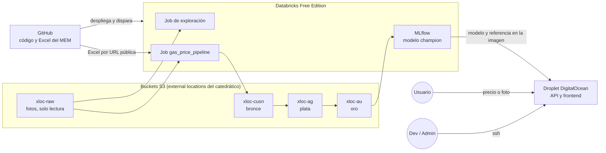
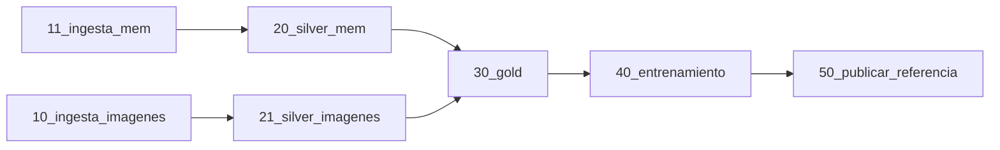

# Arquitectura

## Vista general



Los buckets solo se tocan desde Databricks, con la credencial que configuró el catedrático. Nadie del equipo necesita credenciales de AWS.

## Jobs

### Job de exploración: `gas_price_exploracion`

Corre a mano, cuando haga falta conocer los datos. No escribe nada.

| Tarea | Notebook | Qué hace |
|---|---|---|
| exploracion_raw | `00_exploracion_raw.py` | Inventario de archivos, EXIF y miniaturas de las fotos en raw |

### Job del pipeline: `gas_price_pipeline`



| Tarea | Lee | Escribe |
|---|---|---|
| 10_ingesta_imagenes | Fotos en raw | `bronze.imagenes` |
| 11_ingesta_mem | Excel en el repo público | Copia del Excel en bronce y `bronze.mem_precios` |
| 20_silver_mem | `bronze.mem_precios` | `silver.precios_oficiales` |
| 21_silver_imagenes | `bronze.imagenes` y `bronze.correcciones_manuales` | Tablas de plata de imágenes |
| 30_gold | Plata | `gold.precios_diarios`, `gold.features_semanales` y `gold.referencia_actual` |
| 40_entrenamiento | `gold.features_semanales` | Modelo en MLflow |
| 50_publicar_referencia | `gold.referencia_actual` | Archivo de referencia para la API |

Nunca corren más de 2 tareas en paralelo, dentro del límite de 5 de Free Edition.

**Carga incremental:**

1. Las fotos se leen con Auto Loader. Guarda un checkpoint en bronce y solo procesa archivos nuevos. Es la comparación entre el bucket y bronce, sin programarla a mano.
2. El Excel solo se carga si su hash cambió.
3. Cada capa escribe con `MERGE` por llave. Correr el job dos veces no duplica datos.
4. El entrenamiento solo corre si `gold.features_semanales` cambió.

**Disparadores:** sin calendario. El job se corre a mano, desde GitHub Actions cuando cambia el Excel, o con un file arrival trigger cuando llegan fotos nuevas a raw. Raw tiene los file events activados. Falta confirmar que Free Edition permita este tipo de disparador.

## OCR en Databricks

El cómputo serverless no permite instalar Tesseract, que es lo que usaba la Actividad 2. Opciones a evaluar en la fase 3:

| Opción | Ventaja | Desventaja |
|---|---|---|
| EasyOCR con pip | Corre en serverless | Es pesado y puede gastar mucha cuota |
| Modelo de visión servido por Databricks | No hay que instalar nada | Hay que confirmar disponibilidad y límites en Free Edition |
| OCR fuera de Databricks | Se reutiliza el código de la Actividad 2 tal cual | El procesamiento sale de la plataforma |

El EXIF sí se puede leer en serverless con Pillow y pillow-heif, sin programas externos.

## Servicio en el Droplet

1. **API:** FastAPI, basada en [Actividades/Actividad5/services/serving](https://github.com/SergioAle210/ML-Engineering/tree/main/Actividades/Actividad5/services/serving) del repo del curso. Endpoint `/evaluar-precio` y, en la fase 7, `/evaluar-foto`.
2. **Frontend:** una página simple servida por la misma API.
3. **Modelo y referencia:** se incluyen en la imagen de Docker durante el CI. El Droplet no consulta Databricks en cada request.
4. **Foto como entrada:** en el Droplet sí se puede instalar Tesseract dentro de Docker y reutilizar el código de la Actividad 2.

## Estructura de carpetas

```
MLOPS_GAS_PRICES_PROJECT/
├── databricks.yml          definición del bundle
├── resources/              jobs del bundle
├── databricks/notebooks/   notebooks de cada tarea
├── .github/workflows/      plan y despliegue del bundle
├── docs/
├── data/
│   ├── mem/
│   └── correcciones/
├── infra/sql/              script de catálogo y esquemas
├── src/gas_price/
├── tests/
└── serving/
```

Los notebooks van en formato fuente de Databricks (`.py`), para que los cambios se puedan revisar en los pull requests.
