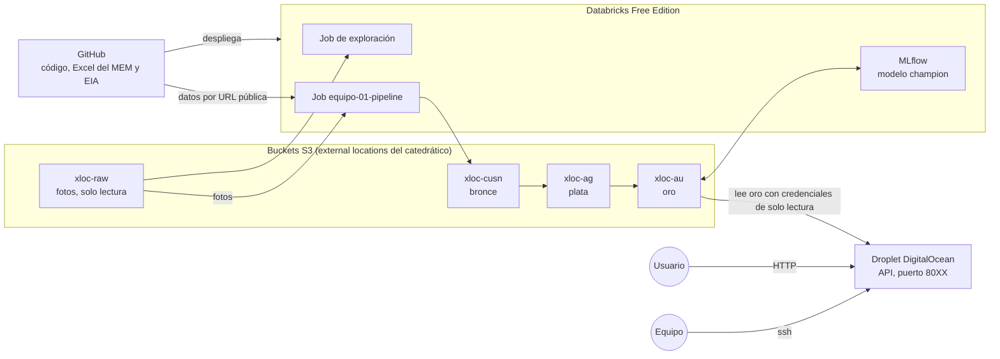
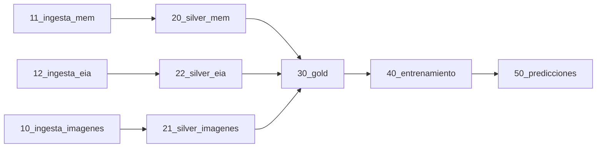

# Arquitectura

## Vista general



1. Databricks usa los buckets por medio de las external locations que configuró el catedrático. Nadie del equipo tiene credenciales de AWS en el código.
2. Según el enunciado, la API lee las tablas de oro desde S3 con credenciales de solo lectura, guardadas en un archivo `.env` del Droplet y nunca en el repo. Esas credenciales todavía no las tenemos: hay que pedirlas al catedrático.

## Jobs

### Job de exploración: `equipo-01-exploracion`

Corre a mano, cuando haga falta conocer los datos. No escribe nada.

| Tarea | Notebook | Qué hace |
|---|---|---|
| exploracion_raw | `00_exploracion_raw.py` | Inventario de archivos, EXIF y miniaturas de las fotos en raw |

### Job de estructura: `equipo-01-setup`

Lo corre el CI después de cada despliegue. Se puede correr a mano, por ejemplo después de borrar una tabla.

| Tarea | Notebook | Qué hace |
|---|---|---|
| crear_tablas | `05_crear_tablas.py` | Corre `databricks/sql/tablas.sql`. Crea las tablas que falten, con sus columnas y tipos. No modifica las que ya existen |

### Job del pipeline: `equipo-01-pipeline`



| Tarea | Lee | Escribe |
|---|---|---|
| 10_ingesta_imagenes | Fotos en el bucket, por external location | `bronze.fotos_precios`. Pendiente |
| 11_ingesta_mem | Excel en el repo público | Copia del Excel en bronce y `bronze.mem_precios` |
| 12_ingesta_eia | Archivos de la EIA en el repo público | `bronze.eia_precios` |
| 20_silver_mem | `bronze.mem_precios` | `silver.precios_oficiales` |
| 22_silver_eia | `bronze.eia_precios` | `silver.precios_internacionales` |
| 21_silver_imagenes | `bronze.fotos_precios` | `silver.precios` y `silver.precios_rejected`. Pendiente |
| 30_gold | Plata, incluida `silver.precios` de las fotos | `gold.precios_diarios`, `gold.precio_semanal`, `gold.variacion_semanal`, `gold.features_modelo` y `gold.referencia_actual` |
| 40_entrenamiento | `gold.features_modelo` | Modelo en MLflow y una fila en `gold.metricas_modelo` |
| 50_predicciones | `gold.features_modelo` y el modelo `champion` | `gold.predicciones`: la predicción de la semana siguiente y, cuando se conoce, la dirección real |

**Relación con las 3 tareas del enunciado.** El enunciado propone un job con 3 tareas encadenadas: bronce, plata y oro. Este job sigue ese mismo orden, pero separa cada capa en una tarea por fuente: 1x es bronce, 2x es plata y 3x a 5x es oro. Así cada tarea se puede probar y volver a correr por separado, y las fuentes avanzan en paralelo.

Nunca corren más de 3 tareas en paralelo, dentro del límite de 5 de Free Edition.

**Carga incremental:**

1. Las fotos se leen con Auto Loader. Guarda un checkpoint en bronce y solo procesa archivos nuevos. Es la comparación entre el bucket y bronce, sin programarla a mano.
2. El Excel del MEM y los archivos de la EIA solo se cargan si su hash cambió.
3. Correr el job dos veces no duplica datos. Bronce agrega una versión solo si su huella es nueva. Las tablas de plata del MEM y la EIA se reescriben completas, porque cada archivo trae la historia entera. Las fotos, que llegan de a una, se escriben con `MERGE` por llave.
4. El entrenamiento solo corre si `gold.features_modelo` cambió. Compara una huella de los datos contra la etiqueta `huella_datos` de las corridas anteriores en MLflow.

**Disparadores y alertas:**

1. **Programación semanal:** cada martes a las 8:00, hora de Guatemala, porque el MEM publica los precios de referencia los martes. Está en `resources/pipeline.yml`.
2. **A mano:** con **Run now**, por ejemplo después de actualizar los datos.
3. **Alerta por correo** si el job falla, al correo de la variable `correo_alertas` de `databricks.yml`.
4. **Llegada de fotos:** el enunciado también acepta un file arrival trigger. Raw tiene los file events activados. Falta confirmar que Free Edition lo permita.

**Cómputo.** Free Edition solo tiene cómputo serverless, sin clusters propios. El enunciado pide un cluster interactivo para desarrollar y un job cluster para el job, o el cómputo que indique el catedrático. La equivalencia: los notebooks se desarrollan en serverless interactivo, y el job corre en serverless de jobs, que se asigna al iniciar la corrida y se libera al terminar, igual que un job cluster. Se documenta en [databricks.md](../infraestructura/databricks.md).

## Fotos

Las fotos son la fuente principal según el enunciado. Lo que pide:

1. **Bronce:** `bronze.fotos_precios`, con el contenido binario, `path`, `modificationTime`, `length` y las columnas de auditoría `_ingestion_timestamp` y `_source_file`. Carga incremental, sin duplicar.
2. **Plata:** extraer el precio de cada foto con OCR o un modelo de visión y escribir `silver.precios` con fecha, combustible, precio en quetzales por galón, modalidad, ubicación y foto de origen. Al menos 3 reglas de calidad, con las filas rechazadas en `silver.precios_rejected` y su motivo. Escritura con `MERGE` por fecha, ubicación, combustible y modalidad.
3. **Calidad:** revisar a mano al menos 20 fotos y reportar el porcentaje de precios extraídos correctamente.

Lo que ya se sabe de las fotos está en [fuentes_de_datos.md](../datos/fuentes_de_datos.md). La técnica de extracción la elige quien trabaje las fotos. Si se usa OCR, el cómputo serverless no permite instalar Tesseract con apt, así que conviene una librería que se instale con `%pip`, como EasyOCR, o un modelo de visión.

## Servicio en el Droplet

Lo que pide el enunciado:

1. **Acceso:** por ssh con el usuario `equipo-01` y las llaves asignadas. Todo el trabajo vive en `/home/equipo-01/`. No se instalan paquetes del sistema ni se reinicia el servidor.
2. **Entorno aislado:** Docker recomendado, o conda, uv o venv. La elección se justifica en el README.
3. **Lectura de oro:** desde S3, con `deltalake`, DuckDB, Polars o Parquet, y credenciales de solo lectura en un `.env` con permisos 600.
4. **Publicación:** en el puerto `80XX` del equipo, corriendo aunque se cierre la sesión ssh, con `restart: unless-stopped` o `systemd`.
5. **Pruebas de usuario final:** una colección de `curl`, Postman o un script que muestre el precio actual y la predicción de los tres combustibles.

**Endpoints mínimos,** con FastAPI o Flask, con paginación (`?limit=`) y documentación en `/docs`:

| Endpoint | Lee |
|---|---|
| `GET /health` | Nada. Estado del servicio |
| `GET /precios/actual` | `gold.referencia_actual` |
| `GET /precios?combustible=&desde=&hasta=` | `gold.precio_semanal`, con la columna `fuente` para elegir el precio oficial o el de las fotos |
| `GET /prediccion?combustible=` | `gold.predicciones`, la fila más reciente del combustible |
| `GET /modelo/metricas` | `gold.metricas_modelo`, la fila más reciente |

Base de código: [Actividades/Actividad5/services/serving](https://github.com/SergioAle210/ML-Engineering/tree/main/Actividades/Actividad5/services/serving) del repo del curso. La API no carga el modelo: lee las predicciones que el job ya guardó en oro.

## Estructura de carpetas

```
equipo-01-gasolina-gt/
├── databricks.yml          definición del bundle
├── resources/              jobs del bundle
├── databricks/notebooks/   notebooks de cada tarea
├── databricks/sql/         definición de las tablas
├── .github/workflows/      plan y despliegue del bundle
├── docs/
├── data/
│   ├── mem/
│   └── eia/
├── infra/sql/              script de catálogo y esquemas
├── scripts/                actualización de la EIA y evaluación local del modelo
├── src/gas_price/
├── tests/
└── api/                    API del Droplet, por hacer
```

Los notebooks van en formato fuente de Databricks (`.py`), para que los cambios se puedan revisar en los pull requests.
