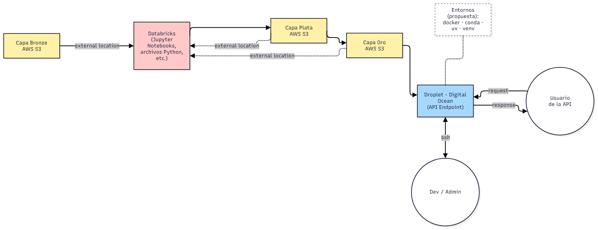

# Caso de uso y contexto

## Enunciado oficial

El enunciado completo está en [enunciado_proyecto_final.pdf](enunciado_proyecto_final.pdf), recibido el 2026-11-13. Define los requisitos, los nombres de tablas, la rúbrica, los entregables y el calendario. Si algo de esta documentación lo contradice, manda el enunciado. El resumen de cumplimiento está en el [plan](../plan/plan_implementacion.md#cumplimiento-del-enunciado).

## Caso de uso original

Así lo planteó el equipo al inicio, antes del enunciado: monitoreo del precio de la gasolina. El usuario ingresa una foto o el precio de la gasolina de hoy. El sistema, entrenado con ML, le dice si es un buen precio y si la tendencia es que suba o baje.

El enunciado se enfoca en la segunda parte: predecir si el precio sube o baja la semana siguiente, a partir de fotos de precios.

## Diagrama entregado por el catedrático

El diagrama propone:

1. Tres capas de datos en buckets de S3: bronce, plata y oro.
2. Databricks como lugar de procesamiento, con notebooks y archivos de Python.
3. Un Droplet de DigitalOcean que expone la API al usuario.
4. Acceso del equipo al Droplet por ssh.
5. Ambientes reproducibles con docker, conda, uv o venv.

En la práctica hay una cuarta capa, raw, configurada por el catedrático. Ver [databricks.md](../infraestructura/databricks.md).

## Resumen del análisis de negocio

El análisis completo está en [analisis_negocio_gasolineras.pdf](analisis_negocio_gasolineras.pdf). Lo esencial para el proyecto:

**Cómo se forma el precio.** El precio en la bomba tiene cuatro componentes: costo internacional del producto, tipo de cambio, impuestos y margen de la estación. Solo el margen cambia entre estaciones.

**Cómo se publica.** El Ministerio de Energía y Minas (MEM) publica precios de referencia de forma semanal, para Súper, Regular y Diésel. El documento indica que la publicación es los martes. Los datos muestran cambios sobre todo los lunes, así que hay que confirmar qué fecha usa el Excel.

**Intervenciones fiscales en 2026:**

| Régimen | Vigencia | Diésel | Regular | Súper |
|---|---|---|---|---|
| Decreto 11-2026 | 1 de mayo al 2 de julio | Q8.00 | Q5.00 | Q5.00 |
| Sin subsidio | Desde el 2 de julio | Ninguno | Ninguno | Ninguno |
| Iniciativa 6801 | Pendiente de aprobación | Q12.00 | Q3.00 | Excluida |

**Decisiones del conductor.** Cuándo cargar, dónde cargar y cuánto cargar. Hoy las toma sin información.

**Objetivos del negocio:**

| Objetivo | Descripción | Decisión |
|---|---|---|
| O1 | Saber rápido si conviene cargar hoy o esperar al cambio de la semana | Cuándo |
| O2 | Evitar llenar el tanque justo antes de una baja de precio | Cuándo |
| O3 | Evitar desvíos a estaciones cuyo ahorro no compensa | Dónde y cuánto |
| O4 | Detectar si la estación habitual ya aplicó el cambio de referencia | Dónde |
| O5 | Evitar pagar la prima de servicio completo sin decidirlo | Modalidad |

Este proyecto ataca sobre todo O1 y O2.

**Datos de referencia del análisis.** La dispersión entre estaciones es de Q0.50 a Q1.00 por galón. El 22 de julio de 2026 la Súper promediaba Q41.07 en autoservicio y Q42.10 en servicio completo, una prima de Q1.03 por galón.

## Código previo que se reutiliza

Está en el [repo del curso](https://github.com/SergioAle210/ML-Engineering), que es público.

| Recurso | Dónde está | Qué aporta |
|---|---|---|
| OCR del dispensador, EXIF, geocodificación, outliers y revisión manual | [Actividades/Actividad2/src](https://github.com/SergioAle210/ML-Engineering/tree/main/Actividades/Actividad2/src) | Base de la extracción de las fotos. Incluye un modelo de Tesseract para dígitos de 7 segmentos |
| Limpieza del Excel del MEM | [Actividades/Actividad2/src/official_prices.py](https://github.com/SergioAle210/ML-Engineering/blob/main/Actividades/Actividad2/src/official_prices.py) | Lectura de la hoja `PUBLICACIÓN WEB` y mapeo de columnas |
| Dataset de 5 fotos procesadas | [Actividades/Actividad2/data/processed/gasolina_dataset.csv](https://github.com/SergioAle210/ML-Engineering/blob/main/Actividades/Actividad2/data/processed/gasolina_dataset.csv) | Esquema de columnas ya probado |
| Dashboard de revisión manual | [Actividades/Actividad2/app.py](https://github.com/SergioAle210/ML-Engineering/blob/main/Actividades/Actividad2/app.py) | Patrón de revisión humana con Streamlit |
| Fotos de prueba | [Casos-Estudio/Images](https://github.com/SergioAle210/ML-Engineering/tree/main/Casos-Estudio/Images) | 5 fotos HEIC de julio de 2026, de una sola estación |
| Entrenamiento con MLflow y registro en Unity Catalog con alias | [Ejercicios/Ejercicio5](https://github.com/SergioAle210/ML-Engineering/tree/main/Ejercicios/Ejercicio5) | Patrón de entrenamiento y registro del modelo |
| API con FastAPI, Dockerfiles y docker compose | [Actividades/Actividad5](https://github.com/SergioAle210/ML-Engineering/tree/main/Actividades/Actividad5) | Base del servicio en el Droplet |
| Workflows de GitHub Actions | [.github/workflows](https://github.com/SergioAle210/ML-Engineering/tree/main/.github/workflows) | Patrón de CI usado en el curso |
| Medallion local con notebooks y tests | [Casos-Estudio/Caso-Estudio-2](https://github.com/SergioAle210/ML-Engineering/tree/main/Casos-Estudio/Caso-Estudio-2) | Estructura de capas y tests de plata |
| Empaquetado, entrypoints y ambientes | [Tareas/tarea 4](https://github.com/SergioAle210/ML-Engineering/tree/main/Tareas/tarea%204), [Talleres/Taller2](https://github.com/SergioAle210/ML-Engineering/tree/main/Talleres/Taller2) | Paquete instalable y ambientes reproducibles |
