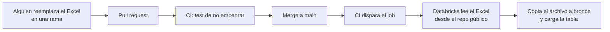

# Fuentes de datos

## 1. Precios oficiales del MEM

**Archivo:** `data/mem/precios_promedio_nacionales_diarios.xlsx`. Es la publicación "Precios promedio nacionales diarios" de la Dirección General de Hidrocarburos del MEM, hoja `PUBLICACIÓN WEB`.

**Contenido (versión del 2026-11-10):**

1. 4,359 filas con fecha válida, del 8 de febrero de 2013 al 10 de noviembre de 2026. El título interno de la hoja dice "precios promedio monitoreados en Ciudad Capital".
2. Columnas útiles: fecha, tipo de cambio, Gasolina Superior, Gasolina Regular y Aceite Combustible Diésel. Todas en quetzales por galón, salvo el tipo de cambio.
3. **Un precio en 0 significa que ese día no se publicó.** Hay 547 días así, todos de 2017 a 2019, con las tres gasolinas en 0 a la vez. En esos años el MEM publicaba casi solo los lunes. Plata los trata como nulos.
4. Frecuencia de publicación: días hábiles de 2013 a 2016, casi solo lunes de 2017 a 2019 y todos los días desde 2020.
5. 668 días faltantes dentro del rango, además de los días en 0.
6. Un tipo de cambio viene como texto con espacios invisibles, el del 25 de junio de 2019. El lector lo limpia.
7. 3 fechas duplicadas: 25 de agosto de 2015, 1 y 2 de mayo de 2017. Las filas repetidas son copias exactas, con los mismos precios y tipo de cambio. Vienen así en la publicación del MEM. Plata deja una sola fila. Si alguna vez una fecha repetida trae valores distintos, el pipeline falla.
8. Las filas finales son notas de fuente. Explican dos cambios de régimen: un subsidio del 28 de abril al 5 de julio de 2026 y la exención de impuestos desde el 1 de octubre de 2026, por el Decreto 22-2026. Plata los guarda en la columna `regimen_fiscal`.

**Cambios semanales.** Tomando el precio de la Súper de cada lunes, hay 718 semanas. El cambio contra la semana anterior baja en 38 %, sube en 32 % y se mantiene en 30 %, con un umbral de Q0.10. Repetir la dirección de la semana anterior acierta en 44 % de las semanas.

**Código:** el lector y las reglas están en `src/gas_price/mem.py`. Lo usan los notebooks y los tests.

**Por qué es la fuente principal:** 13 años de datos diarios dan cientos de cambios semanales de precio. Eso alcanza para entrenar y validar un modelo de series de tiempo. Las fotos no.

**Por qué vive en el repo:** se intentó descargar el Excel de forma automática desde la web del MEM y no funcionó de forma confiable. Versionarlo en el repo deja un historial de cada actualización y permite validarla antes de usarla.

### Cómo se actualiza



1. El archivo no se sube a raw porque raw es solo de lectura.
2. Databricks lee el Excel directo del repo público. GitHub Actions no necesita escribir en los buckets.
3. La tarea de ingesta calcula el hash del archivo. Si no cambió, no lo vuelve a cargar.

### Test de "no empeorar"

Corre en cada pull request, con el workflow `tests.yml`. Compara la versión nueva contra la que está en `main`. Está en `tests/test_no_empeorar.py`.

| Regla | Falla si |
|---|---|
| Columnas obligatorias | Falta FECHA, Tipo de Cambio, Gasolina Superior, Gasolina Regular o Aceite Combustible Diésel |
| Sin pérdida de fechas | Una fecha de la versión anterior ya no está |
| Sin cambios silenciosos | Cambia el precio o el tipo de cambio de una fecha que ya existía |
| Sin nulos nuevos | Queda sin dato, o en 0, un valor que antes existía |
| Sin fechas en conflicto | Una fecha aparece repetida con valores distintos |
| Rango razonable | Un precio queda fuera de Q10 a Q80 por galón |

Para correrlo en local, ver las instrucciones al inicio del archivo del test.

Si un cambio de precio histórico es intencional, por ejemplo una corrección del MEM, se justifica en el pull request y se aprueba a mano.

## 2. Precios internacionales de la EIA

**Qué es:** precios spot diarios en dólares por galón que publica la EIA, la agencia de información energética de EE. UU. Son datos públicos. Se usan dos series de la Costa del Golfo, el mercado de referencia para los combustibles que importa Guatemala.

| Archivo en `data/eia/` | Serie de la EIA | Sigue a | Desde |
|---|---|---|---|
| `gasolina_costa_golfo_diario.xls` | [EER_EPMRU_PF4_RGC_DPG](https://www.eia.gov/dnav/pet/hist/LeafHandler.ashx?n=PET&s=EER_EPMRU_PF4_RGC_DPG&f=D), gasolina regular convencional | Súper y regular | 1986 |
| `diesel_costa_golfo_diario.xls` | [EER_EPD2DXL0_PF4_RGC_DPG](https://www.eia.gov/dnav/pet/hist/LeafHandler.ashx?n=PET&s=EER_EPD2DXL0_PF4_RGC_DPG&f=D), diésel de ultra bajo azufre | Diésel | 2006 |

**Por qué la Súper y la Regular comparten una serie:**

1. La EIA no publica precio spot de gasolina premium. Su [tabla de precios spot](https://www.eia.gov/dnav/pet/pet_pri_spt_s1_d.htm) solo tiene gasolina regular, diésel y otros productos.
2. En los datos del MEM, la Súper y la Regular se mueven juntas. En 97 % de las semanas van en la misma dirección, sus cambios semanales tienen una correlación de 0.96 y la Súper cuesta en promedio Q1.31 más.
3. El modelo usa cambios, no niveles. Las variables internacionales miden cuánto cambió el precio, y la brecha se compara contra su propio promedio de 8 semanas. La diferencia fija entre las dos gasolinas se cancela.
4. El diésel sí tiene serie propia, porque se mueve distinto: sus cambios tienen una correlación de 0.79 con los de las gasolinas.

La relación entre combustible y serie está en `SERIES`, en `src/gas_price/eia.py`.

**Por qué se agregó:** el precio local sigue al internacional con una o dos semanas de atraso. Sin este dato, el modelo no supera a la regla de repetir la dirección de la semana anterior. Ver [modelo.md](../modelo/modelo.md).

**Formato:** archivo `.xls` con la hoja `Data 1`, dos filas de títulos y luego fecha y precio. Solo vienen los días con mercado abierto. El lector está en `src/gas_price/eia.py`.

**Cómo se actualiza:** con un script, desde la raíz del repo y con el paquete instalado:

```
git switch -c datos/actualizacion-eia
python scripts/actualizar_eia.py
```

1. El script descarga las dos series y valida cada una con las reglas de "no empeorar" antes de reemplazar el archivo.
2. Si una serie tiene problemas, no la toca y los muestra.
3. Al final imprime cuántos días nuevos trae cada serie.
4. Después se hace commit y se abre un pull request, que vuelve a pasar por el test de "no empeorar".

Se prefirió un script a un workflow programado: un workflow abriría un pull request automático cada semana y necesitaría un token extra. Con el script, una persona decide cuándo actualizar, por ejemplo junto con el Excel del MEM.

Databricks lee los archivos desde el repo público, porque no está confirmado que `eia.gov` esté entre los dominios permitidos de Free Edition.

## Ciclo semanal de actualización

El precio oficial cambia casi siempre los lunes. Ese día hay que actualizar los datos para que la API y el modelo estén al día.

| Paso | Quién o qué | Automático |
|---|---|---|
| 1. Descargar el Excel del MEM y reemplazarlo en `data/mem/` | Una persona del equipo | No |
| 2. Correr `python scripts/actualizar_eia.py` | Una persona del equipo | La descarga sí |
| 3. Abrir un pull request | Una persona del equipo | No |
| 4. Validar que los datos no empeoren | Workflow `tests.yml` | Sí |
| 5. Correr el job `gas_price_pipeline` | Una persona del equipo | No |
| 6. Recalcular `gold.referencia_actual` y reentrenar el modelo | El job | Sí |
| 7. Reconstruir la imagen de la API | CI, al definirse la fase 6 | Por definir |

**Qué es la referencia.** Es el precio oficial vigente de cada combustible: el último que publicó el MEM. Vive en `gold.referencia_actual`. Contra ella se juzga si el precio que ingresa el usuario es bueno, normal o caro. No es un endpoint: el CI la copia a la imagen de la API junto con el modelo.

**Si nadie actualiza,** la API sigue funcionando, pero compara contra el precio de la última actualización y el modelo predice con datos viejos. Por eso la referencia incluye `fecha_referencia`, para que la API pueda mostrar de cuándo es.

## 3. Fotos de dispensadores

**Dónde están:** en el bucket de la external location `xloc-raw`, que es solo de lectura.

### Resultado de la exploración (2026-11-12)

Se obtuvo con el job `gas_price_exploracion`, que corre el notebook `databricks/notebooks/00_exploracion_raw.py`. No forma parte del pipeline y no escribe nada.

| Pregunta | Resultado |
|---|---|
| Cantidad | 110 archivos, 169 MB en total |
| Formatos | 109 HEIC y 1 JPG |
| Carpetas | `img/` (38), `img/2025/` (31), `img/2024/` (24) y `img/2023/` (17) |
| Metadatos | Las 110 fotos tienen fecha y GPS en el EXIF. Ninguna falló al abrirse |
| Fechas de toma | Del 14 de diciembre de 2022 al 8 de noviembre de 2026, con 1 a 6 fotos casi todos los meses |
| Dispositivos | iPhone 14 (91) y iPhone XS (19) |
| Lugares | Al menos 13 lugares distintos, redondeando el GPS a unos 100 metros. Uno concentra 63 fotos y otro 17. El resto tiene 6 fotos o menos |
| Perfil de color | Display P3, el de los iPhone. Hay que convertir a sRGB para mostrar las fotos |
| Resolución | 3024 por 4032 en 108 fotos verticales. 2 fotos son horizontales |
| El único JPG | `IMG_3605.JPG`, de mayo de 2023, horizontal y del iPhone XS |
| Hora de toma | Entre las 6:00 y las 22:00, con mediana a las 19:00. 74 fotos son de noche (18:00 o más tarde) y 36 de día |
| Repetidas | Ninguna. Las 110 fotos tienen contenido distinto según su huella SHA256 |
| Dispositivo por año | iPhone XS hasta 2023, iPhone 14 desde 2023 |
| Integridad | `IMG_8271` e `IMG_8286` del bucket tienen la misma huella SHA256 que las copias del repo del curso. Las fotos del bucket son las originales, sin modificar |

**Fotos por año en los lugares principales:**

| Lugar | 2022 | 2023 | 2024 | 2025 | 2026 |
|---|---|---|---|---|---|
| Lugar principal | 1 | 14 | 14 | 12 | 22 |
| Segundo lugar | 1 | 3 | 1 | 6 | 6 |
| Tercer lugar | 0 | 1 | 0 | 3 | 2 |
| Otros | 0 | 3 | 2 | 11 | 8 |

**Fotos por carpeta y año de toma:**

| Carpeta | 2022 | 2023 | 2024 | 2025 | 2026 |
|---|---|---|---|---|---|
| `img/` | 0 | 0 | 0 | 0 | 38 |
| `img/2023/` | 2 | 15 | 0 | 0 | 0 |
| `img/2024/` | 0 | 6 | 17 | 1 | 0 |
| `img/2025/` | 0 | 0 | 0 | 31 | 0 |

No se publican coordenadas exactas en el repo, porque es público y las fotos muestran los recorridos de una persona.

**Hallazgos que afectan el diseño:**

1. **La carpeta no indica con exactitud el año de la foto.** `img/2023/` tiene fotos de diciembre de 2022 e `img/2024/` tiene fotos de 2023 y 2025. La fecha siempre sale del EXIF.
2. **El monto de la carga no es fijo.** Las miniaturas muestran Q100, Q200 y Q300. La Actividad 2 usaba Q150 como valor de referencia para validar el OCR, y eso ya no aplica.
3. **Hay más de un tipo de dispensador.** La mayoría son de la misma marca, pero al menos uno es de otra marca con otra distribución de pantallas. La técnica que lea el precio no puede depender de posiciones fijas.
4. **110 fotos en casi 4 años no alcanzan para entrenar** un modelo semanal. Se confirma que el Excel del MEM es la fuente principal. Las fotos sirven para comparar estaciones contra el promedio nacional, sobre todo la estación con 63 fotos.
5. **El lugar principal tiene fotos todos los años**, con 12 a 22 por año desde 2023. Es la única estación con datos suficientes para comparar su precio contra el promedio nacional a lo largo del tiempo.
6. **La mayoría de las fotos son de noche**, con luz artificial, pantallas retroiluminadas y reflejos. La técnica que lea el precio tiene que tolerar eso y los distintos dispensadores.
7. **La orientación varía.** Hay que aplicar la orientación del EXIF antes de cualquier recorte o lectura.
8. **La huella SHA256 sirve como llave de cada foto en bronce.** No hay contenidos repetidos, así que identifica cada foto sin ambigüedad aunque cambie su nombre o su carpeta.

**Etiquetas EXIF disponibles:** las fotos tienen 62 etiquetas distintas. Cobertura de las que usa el proyecto:

| Etiqueta | Fotos | Cobertura |
|---|---|---|
| `DateTimeOriginal`, `OffsetTimeOriginal`, `GPSLatitude`, `GPSLongitude`, `GPSAltitude`, `GPSHPositioningError`, `Model`, `Software`, `Orientation` | 110 | 100 % |
| `GPSDateStamp` | 109 | 99 % |
| `GPSTimeStamp` | 91 | 83 % |

La fecha de cada foto sale de `DateTimeOriginal` con su zona horaria, porque está siempre.

**Qué se usó en la exploración:** solo los metadatos del EXIF. No se leyeron los números de las fotos.

### Cómo se aprovechan las fotos: tema abierto

Lo decide quien trabaje las fotos. Lo que ya se sabe:

1. El EXIF da la fecha, la hora y el lugar de cada foto. Eso ya es información estructurada.
2. Lo difícil es convertir lo que muestra la imagen en datos de una tabla. Una opción es leer el precio con OCR o con un modelo de visión. No hay nada decidido.
3. Las imágenes no salen de Databricks. El Droplet no tiene acceso al bucket, así que ahí solo pueden llegar datos ya estructurados.
