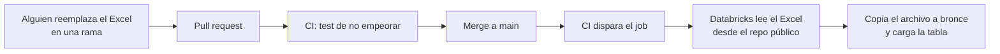

# Fuentes de datos

## 1. Precios oficiales del MEM

**Archivo:** `data/mem/precios_promedio_nacionales_diarios.xlsx`. Es la publicación "Precios promedio nacionales diarios" de la Dirección General de Hidrocarburos del MEM, hoja `PUBLICACIÓN WEB`.

**Contenido (versión del 2026-11-10):**

1. 4,359 días con fecha válida, del 8 de febrero de 2013 al 10 de noviembre de 2026.
2. Columnas útiles: fecha, tipo de cambio, Gasolina Superior, Gasolina Regular y Aceite Combustible Diésel. Todas en quetzales por galón, salvo el tipo de cambio.
3. Sin nulos en esas columnas.
4. 668 días faltantes dentro del rango.
5. 3 fechas duplicadas: 25 de agosto de 2015, 1 y 2 de mayo de 2017. Las filas repetidas son copias exactas, con los mismos precios y tipo de cambio. Vienen así en la publicación del MEM.
6. El precio de la Súper cambió en 798 días: 561 lunes, 180 martes y el resto otros días.
7. Las filas finales son notas de fuente. Una nota explica el subsidio del 28 de abril al 5 de julio de 2026.

**Por qué es la fuente principal:** 13 años de datos diarios dan cientos de cambios semanales de precio. Eso alcanza para entrenar y validar un modelo de series de tiempo. Las fotos no.

**Por qué vive en el repo:** se intentó descargar el Excel de forma automática desde la web del MEM y no funcionó de forma confiable. Versionarlo en el repo deja un historial de cada actualización y permite validarla antes de usarla.

### Cómo se actualiza

1. El archivo no se sube a raw porque raw es solo de lectura.
2. Databricks lee el Excel directo del repo público. GitHub Actions no necesita escribir en los buckets.
3. La tarea de ingesta calcula el hash del archivo. Si no cambió, no lo vuelve a cargar.

### Test de "no empeorar"

Corre en cada pull request que cambia el Excel. Compara la versión nueva contra la que está en `main`.

| Regla | Falla si |
|---|---|
| Columnas obligatorias | Falta FECHA, Tipo de Cambio, Gasolina Superior, Gasolina Regular o Aceite Combustible Diésel |
| Sin pérdida de fechas | Una fecha de la versión anterior ya no está |
| Sin cambios silenciosos | Cambia el precio de una fecha que ya existía |
| Sin nulos nuevos | Aparecen nulos donde antes había datos |
| Sin duplicados nuevos | Aparece una fecha repetida que antes no estaba |
| Rango razonable | Un precio queda fuera de Q10 a Q80 por galón |

Si un cambio de precio histórico es intencional, por ejemplo una corrección del MEM, se justifica en el pull request y se aprueba a mano.

## 2. Fotos de dispensadores

**Dónde están:** en el bucket de la external location `xloc-raw`, que es solo de lectura.

### Resultado de la exploración (2026-11-12)

Se obtuvo con el job `gas_price_exploracion`, que corre el notebook `databricks/notebooks/00_exploracion_raw.py`. No forma parte del pipeline y no escribe nada.

| Pregunta | Resultado |
|---|---|
| Cantidad | 110 archivos, 169 MB en total |
| Formatos | 109 HEIC y 1 JPG |
| Carpetas | `img/` (38), `img/2025/` (31), `img/2024/` (24) y `img/2023/` (17) |
| Metadatos | Las 110 fotos tienen fecha y GPS en el EXIF. Ninguna falló al abrirse |
| Fechas de toma | Del 14 de diciembre de 2022 al 8 de noviembre de 2026, con 1 a 6 fotos casi todos los meses |
| Dispositivos | iPhone 14 (91) y iPhone XS (19) |
| Lugares | Al menos 13 lugares distintos, redondeando el GPS a unos 100 metros. Uno concentra 63 fotos y otro 17. El resto tiene 6 fotos o menos |
| Perfil de color | Display P3, el de los iPhone. Hay que convertir a sRGB para mostrar las fotos |
| Resolución | 3024 por 4032 en 108 fotos verticales. 2 fotos son horizontales |
| El único JPG | `IMG_3605.JPG`, de mayo de 2023, horizontal y del iPhone XS |
| Hora de toma | Entre las 6:00 y las 22:00, con mediana a las 19:00. 74 fotos son de noche (18:00 o más tarde) y 36 de día |
| Repetidas | Ninguna. Las 110 fotos tienen contenido distinto según su huella SHA256 |
| Dispositivo por año | iPhone XS hasta 2023, iPhone 14 desde 2023 |
| Integridad | `IMG_8271` e `IMG_8286` del bucket tienen la misma huella SHA256 que las copias del repo del curso. Las fotos del bucket son las originales, sin modificar |

**Fotos por año en los lugares principales:**

| Lugar | 2022 | 2023 | 2024 | 2025 | 2026 |
|---|---|---|---|---|---|
| Lugar principal | 1 | 14 | 14 | 12 | 22 |
| Segundo lugar | 1 | 3 | 1 | 6 | 6 |
| Tercer lugar | 0 | 1 | 0 | 3 | 2 |
| Otros | 0 | 3 | 2 | 11 | 8 |

**Fotos por carpeta y año de toma:**

| Carpeta | 2022 | 2023 | 2024 | 2025 | 2026 |
|---|---|---|---|---|---|
| `img/` | 0 | 0 | 0 | 0 | 38 |
| `img/2023/` | 2 | 15 | 0 | 0 | 0 |
| `img/2024/` | 0 | 6 | 17 | 1 | 0 |
| `img/2025/` | 0 | 0 | 0 | 31 | 0 |

No se publican coordenadas exactas en el repo, porque es público y las fotos muestran los recorridos de una persona.

**Hallazgos que afectan el diseño:**

1. **La carpeta no indica con exactitud el año de la foto.** `img/2023/` tiene fotos de diciembre de 2022 e `img/2024/` tiene fotos de 2023 y 2025. La fecha siempre sale del EXIF.
2. **El monto de la carga no es fijo.** Las miniaturas muestran Q100, Q200 y Q300. La Actividad 2 usaba Q150 como valor de referencia para validar el OCR, y eso ya no aplica.
3. **Hay más de un tipo de dispensador.** La mayoría son de la misma marca, pero al menos uno es de otra marca con otra distribución de pantallas. La técnica que lea el precio no puede depender de posiciones fijas.
4. **110 fotos en casi 4 años no alcanzan para entrenar** un modelo semanal. Se confirma que el Excel del MEM es la fuente principal. Las fotos sirven para comparar estaciones contra el promedio nacional, sobre todo la estación con 63 fotos.
5. **El lugar principal tiene fotos todos los años**, con 12 a 22 por año desde 2023. Es la única estación con datos suficientes para comparar su precio contra el promedio nacional a lo largo del tiempo.
6. **La mayoría de las fotos son de noche**, con luz artificial, pantallas retroiluminadas y reflejos. La técnica que lea el precio tiene que tolerar eso y los distintos dispensadores.
7. **La orientación varía.** Hay que aplicar la orientación del EXIF antes de cualquier recorte o lectura.
8. **La huella SHA256 sirve como llave de cada foto en bronce.** No hay contenidos repetidos, así que identifica cada foto sin ambigüedad aunque cambie su nombre o su carpeta.

**Etiquetas EXIF disponibles:** las fotos tienen 62 etiquetas distintas. Cobertura de las que usa el proyecto:

| Etiqueta | Fotos | Cobertura |
|---|---|---|
| `DateTimeOriginal`, `OffsetTimeOriginal`, `GPSLatitude`, `GPSLongitude`, `GPSAltitude`, `GPSHPositioningError`, `Model`, `Software`, `Orientation` | 110 | 100 % |
| `GPSDateStamp` | 109 | 99 % |
| `GPSTimeStamp` | 91 | 83 % |

La fecha de cada foto sale de `DateTimeOriginal` con su zona horaria, porque está siempre.

**Qué se usó en la exploración:** solo los metadatos del EXIF. No se leyeron los números de las fotos.

### Cómo se aprovechan las fotos: tema abierto

Lo decide quien trabaje las fotos. Lo que ya se sabe:

1. El EXIF da la fecha, la hora y el lugar de cada foto. Eso ya es información estructurada.
2. Lo difícil es convertir lo que muestra la imagen en datos de una tabla. Una opción es leer el precio con OCR o con un modelo de visión. No hay nada decidido.
3. Las imágenes no salen de Databricks. El Droplet no tiene acceso al bucket, así que ahí solo pueden llegar datos ya estructurados.
